<p align="center">
  
</p>

<p align="center">
  <a href="https://github.com/Qwwc/BRQ-Account-Switcher/releases/latest"></a>
  <a href="https://github.com/Qwwc/BRQ-Account-Switcher/releases"></a>
  
  <a href="LICENSE"></a>
</p>

<p align="center">
  <a href="https://github.com/Qwwc/BRQ-Account-Switcher/releases/latest"></a>
  <a href="#how-it-works"></a>
  <br>
  <a href="https://github.com/Qwwc/BRQ-Account-Switcher/issues"></a>
  <a href="#building-from-source"></a>
</p>

<p align="center"><b>Switch between your game accounts in one click, without typing passwords again.</b></p>

---

## Features

- ⚡ **One-click switching:** double-click an account and you're signed in, with a BRQ sign-in splash to confirm it.
- 🎮 **Many platforms:** Steam, Epic Games, Riot Games, Ubisoft Connect, Battle.net, Discord, Rockstar, EA, GOG, Roblox and more.
- 🔒 **No passwords stored:** BRQ only saves and restores each launcher's own sign-in files.
- 🧠 **Smart Epic detection:** only the Epic launcher actually installed on your PC is shown.
- 🎨 **BRQ Violet theme:** glowing tiles, a floating dock, animated menus. Every animation can be turned off in Settings.
- 🛡️ **Private by default:** no telemetry, no crash uploads, nothing sent anywhere.

## How it works

Most launchers remember who is signed in through a few files and registry values. BRQ:

1. **Closes** the launcher.
2. **Saves** the current account's sign-in files.
3. **Restores** the files of the account you picked.
4. **Starts** the launcher again, already signed in to that account.

Each platform is described in [`Platforms.json`](Platforms.json): which programs to close and which files and registry values to swap. Adding a platform means editing that file, not the code.

> [!NOTE]
> BRQ is not made for cheating. All it does is change which account a launcher is signed in to. Use it as you see fit, at your own responsibility.

## Download

Get the latest `BRQ-Acc-Switcher.exe` from **[Releases](https://github.com/Qwwc/BRQ-Account-Switcher/releases/latest)** and run it. No installer is needed. Your data is kept in `%AppData%\BRQ Account Switcher`.

## Building from source

Requirements: Go 1.27.3+, Node.js 24, pnpm 11.0.8 and the Wails CLI 3.1.0:

```
go install github.com/wailsapp/wails/v3/cmd/wails3@v3.1.0
wails3 task windows:build
```

The app is written to `bin/BRQ-Acc-Switcher.exe`.

BRQ helper scripts:

| Command | What it does |
|---|---|
| `node tools/brq/gen_logo.mjs` | Regenerates the vector logo |
| `go run ./tools/brq/icons` | Rebuilds the app and tray icons from `build/brq_logo_source.webp` |
| `node tools/brq/gen_readme_art.mjs` | Regenerates this README's banner and buttons |

Telemetry, the self-updater and Discord status are off because the original versions point at upstream services. To turn them on with your own services, set `UpdateRepo` / `TelemetryEnabled` in `internal/api/api.go` and `clientID` in `internal/discordrpc/manager.go`.

## Credits and licence

BRQ Account Switcher is a modified version of **[TcNo Account Switcher](https://github.com/TCNOco/TcNo-Acc-Switcher)** by TroubleChute (Wesley Pyburn), and is released under the same **GNU General Public License v3.0**. BRQ is independent and is not affiliated with or endorsed by TcNo or TroubleChute. The original README is kept as [README.upstream.md](README.upstream.md).

This program comes with no warranty. Anyone who receives a build is entitled to the complete corresponding source under the same licence. See [LICENSE](LICENSE), [OPEN_SOURCE_LICENSES.txt](OPEN_SOURCE_LICENSES.txt) and [DISCLAIMER.md](DISCLAIMER.md).
